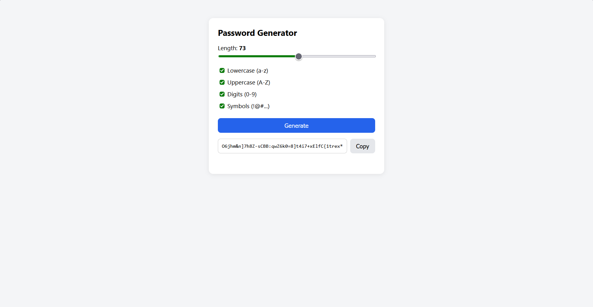

# Password_Gen_App

A web app that generates secure random passwords, built with Java and Spring Boot.
Choose the length and the character types, then copy the result with one click.



## Features

- Length from 16 to 128 characters
- Lowercase, uppercase, digits and symbols, each optional
- Guarantees at least one character from every selected type
- Uses `SecureRandom` (cryptographically secure) instead of `java.util.Random`
- Clear error messages for invalid input
- Copy to clipboard button

## Tech stack

- Java 25
- Spring Boot (Spring Web)
- Maven
- JUnit 5
- Plain HTML, CSS and JavaScript for the front end

## Running it

Requirements: JDK 27 or newer.

```bash
git clone https://github.com/joaojacinto/Password_Gen_App.git
cd Password_Gen_App
./mvnw spring-boot:run
```

On Windows (Command Prompt or PowerShell), use `mvnw spring-boot:run`.

Then open http://localhost:8080 in your browser.

## API

`GET /api/password`

| Parameter | Type    | Default | Description                    |
|-----------|---------|---------|--------------------------------|
| `length`  | int     | 16      | Between 16 and 128             |
| `lower`   | boolean | true    | Include lowercase letters      |
| `upper`   | boolean | true    | Include uppercase letters      |
| `digits`  | boolean | true    | Include digits                 |
| `symbols` | boolean | true    | Include symbols                |

Example:

```
GET /api/password?length=20&lower=false&digits=false
```

Returns the password as plain text with status `200`.
Invalid input (for example a length outside the allowed range, or no character type selected) returns status `400` with a message describing the problem.

## Project structure

```
controller/   Receives HTTP requests and returns the response
service/      Applies the rules (minimum and maximum length)
generator/    The password generation algorithm
exception/    Global handler that turns errors into 400 responses
```

Request flow: `Controller → Service → Generator`, and the result travels back the same way.

## Tests

```bash
./mvnw test
```

The generator tests check the length, that every selected character type is present, that unselected types never appear, and that invalid input is rejected. Randomized checks run 100 times each.

## Notes

This is just a learning project. Passwords are generated on the server and are not stored or logged.